# BÁO CÁO ĐỒ ÁN MÔN HỌC: LẬP TRÌNH HƯỚNG ĐỐI TƯỢNG (OOP)
## ĐỀ TÀI: XÂY DỰNG ỨNG DỤNG QUẢN LÝ THƯ VIỆN (LIBRARY MANAGEMENT SYSTEM)
**Ngôn ngữ thực hiện:** Java 21  
**Kiến trúc:** Object-Oriented Design (OOD), Bottom-Up Architecture, Facade, Custom Array Containers & Observer Pattern  
**Tài liệu thiết kế tham khảo:** [Thiết kế Hướng Đối Tượng Hệ Thống Quản Lý Thư Viện - Viblo](https://viblo.asia/p/thiet-ke-huong-doi-tuong-he-thong-quan-ly-thu-vien-5pPLkRZyJRZ)

---

## 🏆 BẢNG ĐỐI CHIẾU 10 TIÊU CHÍ CHẤM ĐIỂM ĐỒ ÁN (THANG ĐIỂM 10/10)

| STT | Tiêu chí chấm điểm của Giảng viên | Thang điểm | Hiện thực chi tiết trong mã nguồn đồ án | Đánh giá |
| :---: | :--- | :---: | :--- | :---: |
| **1** | **Có ít nhất 15 class** | **1.0 đ** | Tổng cộng **> 35 classes** (Enums, Models, Users, Search, Collections, Notifications, Services, Utils, CLI, Main). | ✅ Đạt tối đa (35/15) |
| **2** | **Các lớp có hàm thiết lập (constructor)** | **1.0 đ** | Tất cả các lớp đều có Constructor mặc định (no-args) và Constructor có tham số để khởi tạo và nạp dữ liệu. | ✅ Đạt tối đa |
| **3** | **Có kế thừa hợp lý (Inheritance)** | **1.0 đ** | `User` $\rightarrow$ `Member`, `Librarian`<br>`Book` $\rightarrow$ `BookItem`<br>`Person` $\rightarrow$ `Author`<br>`Notification` $\rightarrow$ `EmailNotification`, `PostalNotification` | ✅ Đạt tối đa |
| **4** | **Cài đặt và sử dụng đa hình (Polymorphism)** | **1.0 đ** | - Triển khai interface `Search` và `IDanhSach`<br>- Ghi đè phương thức trừu tượng `User.getRole()`, `Notification.sendNotification()`<br>- Ghi đè `toString()`, `equals()`, `hashCode()` | ✅ Đạt tối đa |
| **5** | **Lớp mảng các đối tượng (Array)** | **2.0 đ** | Xây dựng các lớp mảng đối tượng chuyên biệt: `DanhSachSach` (`BookItem[]`), `DanhSachThanhVien` (`Member[]`), `DanhSachMuonTra` (`BookLending[]`), `DanhSachPhat` (`Fine[]`) với đầy đủ: Nhập $n$ phần tử, Xuất danh sách, Thêm 1/Thêm $k$ phần tử, Sửa/Xóa theo mã, Tìm kiếm chính xác & gần đúng, Thống kê số liệu. | ✅ Đạt tối đa (2.0/2.0) |
| **6** | **Đọc và ghi dữ liệu lên file (text)** | **1.0 đ** | `TextFileStorageService.java` và các phương thức `docFileText()`, `ghiFileText()` tại các lớp mảng đối tượng đọc/ghi các file: `data/sach.txt`, `data/thanhvien.txt`, `data/muontra.txt`, `data/phat.txt`. | ✅ Đạt tối đa |
| **7** | **Thuộc tính static, phương thức static** | **1.0 đ** | - Lớp `Constants` chứa hằng số hệ thống `public static final`<br>- Lớp `IdGenerator` sinh mã định danh tự động với `AtomicLong`<br>- Lớp `DateUtils` chứa các hàm tiện ích định dạng ngày tháng `static`<br>- Các phương thức static trong `DataStorageService`, `TextFileStorageService`, `SampleDataLoader` | ✅ Đạt tối đa |
| **8** | **Lớp trừu tượng, hàm trừu tượng (abstract)** | **1.0 đ** | - `abstract class User` có hàm trừu tượng `public abstract String getRole();`<br>- `abstract class Notification` có hàm trừu tượng `public abstract boolean sendNotification();` | ✅ Đạt tối đa |
| **9** | **Có Interface** | **1.0 đ** | - `interface Search` (tìm kiếm sách theo tựa đề, tác giả, chủ đề, ngày xuất bản)<br>- `interface IDanhSach<T>` (chuẩn hóa các thao tác mảng đối tượng: thêm, thêm $k$, sửa, xóa, tìm kiếm, xuất, đọc/ghi file text) | ✅ Đạt tối đa |
| **10** | **Sáng tạo (Creative UI & Features)** | **1.0 đ** | - Giao diện dòng lệnh Terminal CLI chuyên nghiệp<br>- Tự động tính tiền phạt quá hạn và thông báo đa kênh<br>- Cơ chế lưu trữ nhị phân kết hợp Text File tự động | ✅ Đạt tối đa |

---

## 1. TỔNG QUAN VÀ MỤC TIÊU ĐỀ TÀI

### 1.1. Đặt vấn đề
Hệ thống Quản lý Thư viện (Library Management System - LMS) được xây dựng nhằm tự động hóa và tin học hóa toàn diện các hoạt động vận hành trong thư viện:
- Quản lý danh mục sách khái niệm (`Book`) và các bản sao vật lý cụ thể (`BookItem`) kèm mã vạch (Barcode) và vị trí kệ sách (`Rack`).
- Quản lý phân quyền người dùng: Thủ thư (`Librarian`) và Thành viên (`Member`).
- Quản lý thẻ thư viện (`LibraryCard`) gắn liền với từng thành viên.
- Tự động hóa quy trình cho mượn sách (`BookLending`), kiểm soát hạn mức mượn tối đa và thời gian mượn.
- Xử lý quy trình trả sách, tự động phát hiện trễ hạn và tính tiền phạt (`Fine`).
- Quản lý hàng đợi đặt giữ sách (`BookReservation`) khi sách đang được mượn hết.
- Hệ thống thông báo tự động (`Notification`: `EmailNotification`, `PostalNotification`) khi sách quá hạn hoặc khi sách đặt trước có sẵn.
- Cung cấp tính năng tìm kiếm đa tiêu chí (`Search` interface & `Catalog`).

---

## 2. THIẾT KẾ CÁC LỚP MẢNG ĐỐI TƯỢNG (ARRAY CONTAINERS)

Đáp ứng yêu cầu **Bước 2** trong hướng dẫn làm đồ án:

### 2.1. Interface `IDanhSach<T>`
```java
public interface IDanhSach<T> {
    void them(T item);
    void themK(T[] items);
    boolean sua(String ma, T newItem);
    boolean xoa(String ma);
    T timKiemTheoMa(String ma);
    T[] timKiem(String tuKhoa);
    void xuatDanhSach();
    int getSoLuong();
    T[] getDanhSach();
    void docFileText(String filePath);
    void ghiFileText(String filePath);
}
```

### 2.2. Danh sách các lớp Mảng Đối Tượng
1. **`DanhSachSach`**: Quản lý mảng tĩnh `BookItem[]` với cơ chế tự động mở rộng mảng (`moRongMang()`), hỗ trợ nhập $n$ phần tử, xuất bảng danh mục, tìm kiếm theo tựa đề, tác giả, thể loại, thống kê theo thể loại & trạng thái, đọc/ghi tệp `data/sach.txt`.
2. **`DanhSachThanhVien`**: Quản lý mảng `Member[]`, hỗ trợ đăng ký, cấp thẻ thư viện, sửa/xóa, tìm kiếm thành viên, đọc/ghi tệp `data/thanhvien.txt`.
3. **`DanhSachMuonTra`**: Quản lý mảng `BookLending[]`, thống kê số lượt mượn quá hạn, tìm kiếm theo mã thành viên/sách, đọc/ghi tệp `data/muontra.txt`.
4. **`DanhSachPhat`**: Quản lý mảng `Fine[]`, thống kê tổng tiền phạt đã thu và chưa thu, đọc/ghi tệp `data/phat.txt`.

---

## 3. SƠ ĐỒ LỚP UML (CLASS DIAGRAM)

```mermaid
classDiagram
    direction TB

    class IDanhSach~T~ {
        <<interface>>
        +them(T item)
        +themK(T[] items)
        +sua(String ma, T newItem) boolean
        +xoa(String ma) boolean
        +timKiemTheoMa(String ma) T
        +timKiem(String tuKhoa) T[]
        +xuatDanhSach()
        +docFileText(String filePath)
        +ghiFileText(String filePath)
    }

    class DanhSachSach {
        -BookItem[] danhSach
        -int soLuong
        +nhapDanhSach(int n, Scanner sc)
        +thongKeTheoTheLoai() Map
        +thongKeTheoTrangThai() Map
    }
    IDanhSach <|.. DanhSachSach : Implements

    class DanhSachThanhVien {
        -Member[] danhSach
        -int soLuong
    }
    IDanhSach <|.. DanhSachThanhVien : Implements

    class Search {
        <<interface>>
        +searchByTitle(String title) List~Book~
        +searchByAuthor(String authorName) List~Book~
        +searchBySubject(String subject) List~Book~
        +searchByPubDate(LocalDate pubDate) List~Book~
    }

    class Catalog {
        -Map~String, Book~ booksByIsbn
        -Map~String, BookItem~ bookItemsByBarcode
    }
    Search <|.. Catalog : Implements

    class Person {
        -String name
        -Address address
        -String email
        -String phone
    }

    class Author {
        -String description
    }
    Person <|-- Author : Inheritance

    class Book {
        -String isbn
        -String title
        -String subject
        -String publisher
        -List~Author~ authors
    }

    class BookItem {
        -String barcode
        -double price
        -BookFormat format
        -BookStatus status
        -Rack placedAt
    }
    Book <|-- BookItem : Inheritance

    class User {
        <<abstract>>
        -String id
        -String password
        -Person person
        -LibraryCard card
        -AccountStatus status
        +getRole()* String
    }

    class Member {
        -LocalDate dateOfMembership
        -int totalBooksCheckedOut
    }
    User <|-- Member : Inheritance

    class Librarian {
        -String department
        -LocalDate hireDate
    }
    User <|-- Librarian : Inheritance

    class Notification {
        <<abstract>>
        -String notificationId
        -String content
        +sendNotification()* boolean
    }

    class EmailNotification {
        -String emailAddress
    }
    Notification <|-- EmailNotification : Inheritance

    class PostalNotification {
        -Address address
    }
    Notification <|-- PostalNotification : Inheritance
```



---

## 4. HƯỚNG DẪN TRẢ LỜI CÂU HỎI KHI BẢO VỆ ĐỒ ÁN (VẤN ĐÁP)

### Câu 1: "Chỉ cho thầy/cô lớp mảng đối tượng của nhóm em ở đâu?"
- **Trả lời:** Nằm trong package `com.library.collections`, gồm có:
  - `DanhSachSach.java` (quản lý mảng `BookItem[]`)
  - `DanhSachThanhVien.java` (quản lý mảng `Member[]`)
  - `DanhSachMuonTra.java` (quản lý mảng `BookLending[]`)
  - `DanhSachPhat.java` (quản lý mảng `Fine[]`)
- Tất cả đều cài đặt từ interface `IDanhSach<T>`, có cơ chế tự động mở rộng mảng khi đầy (`moRongMang()`), có hàm nhập $n$ phần tử, thêm 1, thêm $k$ phần tử, sửa, xóa, tìm kiếm và thống kê.

### Câu 2: "Tính Đa hình (Polymorphism) thể hiện ở những chỗ nào?"
- **Trả lời:** 
  1. Đa hình qua Interface: `Search` (được triển khai bởi `Catalog`), `IDanhSach<T>` (được triển khai bởi `DanhSachSach`, `DanhSachThanhVien`...).
  2. Đa hình qua Abstract Method: `User.getRole()` trả về `"Thanh vien"` ở lớp `Member` và `"Thu thu"` ở lớp `Librarian`; `Notification.sendNotification()` gửi email ở lớp `EmailNotification` và in phiếu bưu điện ở `PostalNotification`.

### Câu 3: "Dữ liệu được lưu trữ và đọc ghi file như thế nào?"
- **Trả lời:** Hệ thống hỗ trợ 2 cơ chế:
  1. Đọc/Ghi tập tin văn bản thuần (Plain Text File): Thông qua `TextFileStorageService.java` đọc ghi ra các file `.txt` có định dạng phân tách rõ ràng (`data/sach.txt`, `data/thanhvien.txt`, `data/muontra.txt`, `data/phat.txt`).
  2. Lưu trữ đối tượng nhị phân tự động (Serialization): `data/library_state.dat`.

---

## 5. HƯỚNG DẪN CHẠY VÀ DEMO
- **Chạy chương trình (Console):** Nhấp đúp vào [run_cli.bat](file:///c:/DuAnMonHocCntt/DuANOpp/run_cli.bat) (Vào mục **[9]** để demo trực tiếp các thao tác trên mảng đối tượng và file text theo đúng yêu cầu chấm của giảng viên!).
