# BÁO CÁO ĐỒ ÁN MÔN HỌC: LẬP TRÌNH HƯỚNG ĐỐI TƯỢNG (OOP)
## ĐỀ TÀI: XÂY DỰNG ỨNG DỤNG QUẢN LÝ THƯ VIỆN

**Ngôn ngữ:** Java (JDK 11 trở lên) — chương trình chạy trên Console
**Lưu trữ:** file văn bản (`.txt`) trong thư mục `data/`
**Tài liệu thiết kế tham khảo:** [Thiết kế Hướng Đối Tượng Hệ Thống Quản Lý Thư Viện - Viblo](https://viblo.asia/p/thiet-ke-huong-doi-tuong-he-thong-quan-ly-thu-vien-5pPLkRZyJRZ) (yêu cầu R1–R14)

---

## BẢNG ĐỐI CHIẾU 10 TIÊU CHÍ CHẤM ĐIỂM

| STT | Tiêu chí | Điểm | Hiện thực trong mã nguồn |
| :---: | :--- | :---: | :--- |
| 1 | Có ít nhất 15 class | 1đ | **34 class** + 2 interface + 4 enum (danh sách ở mục 2). |
| 2 | Các lớp có hàm thiết lập (constructor) | 1đ | **Tất cả 34 class** đều khai báo constructor. Lớp dữ liệu có nhiều constructor nạp chồng (mặc định / đầy đủ tham số / rút gọn). Lớp tiện ích (`Constants`, `DateUtils`, `IdGenerator`, `NhapLieu`, `TextFileStorageService`, `SampleDataLoader`, `Main`) có constructor `private` để không cho tạo đối tượng. |
| 3 | Có kế thừa hợp lý | 1đ | `User` → `Member`, `Librarian` · `Person` → `Author` · `Book` → `BookItem` · `Notification` → `EmailNotification`, `PostalNotification` · `DanhSachCoBan<T>` → 7 lớp `DanhSach...` |
| 4 | Cài đặt và sử dụng đa hình | 1đ | 5 chỗ dùng thật khi chạy chương trình (mục 5): mảng `User[]`, mảng `Notification[]`, mảng `IDanhSach<?>[]`, lớp cha `DanhSachCoBan` gọi hàm trừu tượng của lớp con, `BookItem.nhap()` ghi đè và gọi `super.nhap()`. |
| 5 | Lớp mảng các đối tượng | 2đ | 7 lớp mảng, kế thừa từ `DanhSachCoBan<T>` (lưu bằng **mảng thuần `T[]` + biến đếm `soLuong`**, không dùng `ArrayList`/`HashMap`). Đây là **nơi lưu dữ liệu thật** của chương trình. Có đủ: nhập n phần tử, xuất, thêm 1, thêm k, sửa, xóa, tìm kiếm, sắp xếp, thống kê, đọc/ghi file (mục 3). |
| 6 | Đọc và ghi dữ liệu lên file (text) | 1đ | 7 file `.txt` trong `data/`. Khởi động thì **đọc** file, sau mỗi thao tác thay đổi dữ liệu thì **ghi** lại file (mục 4). |
| 7 | Thuộc tính static, phương thức static | 1đ | `IdGenerator`: các biến đếm `private static int` dùng chung + phương thức static sinh mã. Ngoài ra có `Constants` (hằng `static final`), `DateUtils`, `NhapLieu`, `TextFileStorageService`, `Address.tuDongText()`, `Book.taoMangTacGia()`, `OperationResult.success()/failure()` (mục 6). |
| 8 | Lớp trừu tượng, hàm trừu tượng | 1đ | `abstract class User` (`getRole()`, `getQuyenHan()`) · `abstract class Notification` (`sendNotification()`, `getNotificationType()`, `getNoiNhanText()`) · `abstract class DanhSachCoBan<T>` (7 hàm trừu tượng). |
| 9 | Có interface | 1đ | `IDanhSach<T>` (chuẩn thao tác của lớp mảng) · `Search` (tìm sách theo tựa đề / tác giả / thể loại / ngày xuất bản, do `DanhSachSach` cài đặt). |
| 10 | Sáng tạo | 1đ | Đặt giữ sách có tự giữ sách khi được trả · tự tính tiền phạt trễ hạn · thông báo tự chọn kênh Email/Bưu điện · thủ thư đăng nhập để khóa thẻ · sắp xếp, thống kê · kiểm tra nhập liệu · sửa file bằng Notepad rồi nạp lại · khôi phục dữ liệu mẫu (mục 7). |

---

## 1. TỔNG QUAN

Chương trình quản lý một thư viện gồm:
- **Sách:** mỗi đầu sách (`Book`: ISBN, tựa đề, tác giả, thể loại…) có thể có nhiều bản sao (`BookItem`: mã vạch, giá, định dạng, trạng thái, vị trí kệ `Rack`).
- **Người dùng:** thủ thư (`Librarian`) và thành viên (`Member`), mỗi người có thẻ thư viện (`LibraryCard`).
- **Nghiệp vụ:** mượn sách (tối đa 10 cuốn, hạn 15 ngày — R7, R8), trả sách, gia hạn (R11), đặt giữ sách đang được mượn (R9, R13), tính tiền phạt trả trễ (5.000đ/ngày), thông báo quá hạn (R12), tìm kiếm sách (R14).

**Các mã yêu cầu trong chú thích code** (theo bài Viblo):

| Mã | Nội dung | Nơi cài đặt |
| :--- | :--- | :--- |
| R1 | Lưu thông tin sách, thành viên và lịch sử mượn | `DanhSachSach`, `DanhSachThanhVien`, `DanhSachMuonTra` |
| R2 | Mỗi cuốn sách có mã riêng và vị trí kệ | `BookItem.barcode`, `Rack` |
| R3 | Sách có ISBN, tựa đề, tác giả, chủ đề, ngày xuất bản | `Book`, `BookItem.publicationDate` |
| R4 | Một đầu sách có nhiều bản sao | `BookItem extends Book` |
| R5 | Hai loại người dùng: thủ thư và thành viên | `User`, `Librarian`, `Member` |
| R6 | Mỗi người dùng có thẻ thư viện, số thẻ duy nhất | `LibraryCard`, `IdGenerator.taoSoThe()` |
| R7 | Mượn tối đa 10 cuốn cùng lúc | `Constants.MAX_BOOKS_ISSUED_TO_A_USER`, `Library.checkoutBook()` |
| R8 | Thời gian mượn tối đa 15 ngày | `Constants.MAX_LENDING_DAYS` |
| R9 | Mỗi cuốn chỉ một người đặt giữ tại một thời điểm | `Library.reserveBook()` |
| R10 | Lưu người mượn/đặt giữ và ngày mượn/đặt giữ | `BookLending`, `BookReservation` |
| R11 | Cho phép gia hạn | `Library.renewBook()` |
| R12 | Thông báo khi sách quá hạn | `Library.checkOverdueBooksAndNotify()` |
| R13 | Sách không có sẵn thì được đặt giữ | `Library.reserveBook()` |
| R14 | Tìm sách theo tựa đề, tác giả, chủ đề, ngày xuất bản | interface `Search`, `DanhSachSach` |

Tiền phạt (use case "Pay fine") không có mã R trong bài Viblo. Nhóm tự bổ sung mức phạt 5.000đ/ngày.

---

## 2. DANH SÁCH LỚP (34 class + 2 interface + 4 enum)

| Package | Lớp | Vai trò |
| :--- | :--- | :--- |
| `com.library` | `Main` | Điểm khởi chạy |
| `cli` | `LibraryCLI` | Giao diện menu Console |
| `collections` | `IDanhSach<T>` *(interface)* | Chuẩn thao tác của lớp mảng |
| | `DanhSachCoBan<T>` *(abstract)* | Lớp cha của mọi lớp mảng: giữ mảng `T[]`, cài đặt thêm/sửa/xóa/tìm/đọc/ghi file |
| | `DanhSachSach`, `DanhSachThanhVien`, `DanhSachThuThu`, `DanhSachMuonTra`, `DanhSachDatCho`, `DanhSachPhat`, `DanhSachThongBao` | 7 lớp mảng đối tượng |
| `models` | `Book`, `BookItem`, `Author`, `Person`, `Address`, `Rack`, `LibraryCard`, `BookLending`, `BookReservation`, `Fine` | Thực thể dữ liệu |
| `users` | `User` *(abstract)*, `Member`, `Librarian` | Người dùng |
| `notifications` | `Notification` *(abstract)*, `EmailNotification`, `PostalNotification` | Thông báo |
| `search` | `Search` *(interface)* | Chức năng tìm kiếm sách |
| `services` | `Library` | Điều phối nghiệp vụ (mượn, trả, gia hạn, đặt giữ, phạt) |
| | `TextFileStorageService` | Đọc/ghi toàn bộ dữ liệu ra file text |
| | `SampleDataLoader` | Tạo bộ mẫu mặc định khi chưa có dữ liệu hoặc khi chọn khôi phục |
| | `OperationResult` | Kết quả nghiệp vụ (thành công/thất bại + thông báo) |
| `utils` | `Constants`, `DateUtils`, `IdGenerator`, `NhapLieu` | Hằng số, ngày tháng, sinh mã, nhập liệu có kiểm tra |
| `enums` | `BookStatus`, `BookFormat`, `AccountStatus`, `ReservationStatus` | Trạng thái, định dạng |

---

## 3. LỚP MẢNG CÁC ĐỐI TƯỢNG (2 điểm)

### 3.1. Thiết kế
```
IDanhSach<T>  (interface: them, themK, sua, xoa, timKiemTheoMa, timKiem, xuatDanhSach,
     ▲          getSoLuong, getDanhSach, xoaTatCa, docFileText, ghiFileText)
     │ implements
DanhSachCoBan<T>  (abstract)
     │  protected T[] danhSach;   // MẢNG đối tượng
     │  protected int soLuong;    // số phần tử thực tế
     │ extends
     ├── DanhSachSach       (BookItem[])        -> data/sach.txt      (+ implements Search)
     ├── DanhSachThanhVien  (Member[])          -> data/thanhvien.txt
     ├── DanhSachThuThu     (Librarian[])       -> data/thuthu.txt
     ├── DanhSachMuonTra    (BookLending[])     -> data/muontra.txt
     ├── DanhSachDatCho     (BookReservation[]) -> data/datcho.txt
     ├── DanhSachPhat       (Fine[])            -> data/phat.txt
     └── DanhSachThongBao   (Notification[])    -> data/thongbao.txt
```
Lớp `Library` giữ 7 đối tượng danh sách này. **Mọi dữ liệu của chương trình nằm trong các mảng này**, chương trình không dùng `ArrayList` hay `HashMap`.

### 3.2. Các thao tác trên mảng (trong `DanhSachCoBan`)
| Thao tác | Cách làm |
| :--- | :--- |
| `them(item)` | Từ chối nếu `null` hoặc trùng mã. Mảng đầy thì `moRongMang()` gấp đôi kích thước (`Arrays.copyOf`), rồi `danhSach[soLuong++] = item`. |
| `themK(T[] items)` | Gọi `them()` cho từng phần tử, trả về số phần tử thêm được. |
| `sua(ma, itemMoi)` | Tìm vị trí theo mã, thay bằng đối tượng mới (mã giữ nguyên). |
| `xoa(ma)` | Tìm vị trí, dồn các phần tử phía sau lên 1 ô, gán `null` ô cuối, `soLuong--`. |
| `timKiemTheoMa(ma)` | Duyệt mảng, so mã không phân biệt hoa thường. |
| `timKiem(tuKhoa)` | Duyệt mảng, lọc phần tử khớp từ khóa vào mảng tạm, cắt mảng vừa đủ số kết quả. |
| `xuatDanhSach()` / `xuatMang(T[])` | In bảng ra màn hình. |
| `docFileText` / `ghiFileText` | Xem mục 4. |

Mỗi lớp con chỉ cài đặt phần riêng: mã của phần tử (`layMa`), cách so khớp từ khóa, cách in một dòng, cách chuyển đối tượng ↔ dòng text. Lớp `DanhSachSach` bổ sung: **nhập n sách** (`nhapDanhSach`), **sắp xếp** theo tựa đề / giá (thuật toán chọn), **thống kê** theo trạng thái, thể loại (dùng 2 mảng song song), số đầu sách, tổng giá trị kho.

---

## 4. ĐỌC VÀ GHI FILE TEXT (1 điểm)

- **Khi khởi động:** đọc 7 file demo có sẵn trong `data/` vào 7 mảng. Nếu thiếu `data/sach.txt`, chương trình tạo bộ mẫu mặc định và ghi ra file.
- **Khi chạy:** sau mỗi thao tác làm thay đổi dữ liệu (thêm, sửa, xóa, mượn, trả…), chương trình ghi lại toàn bộ file.
- **Định dạng:** mỗi dòng là một đối tượng, các trường cách nhau bằng dấu `|`. Dòng bắt đầu bằng `#` là dòng tiêu đề. Ví dụ `data/thanhvien.txt`:
  ```
  # MA_TV|MAT_KHAU|HO_TEN|EMAIL|SDT|DIA_CHI(duong;tp;tinh;zip;quoc gia)|SO_THE|...|SO_SACH_DANG_MUON
  MB-1001|123456|Nguyen Van An|an.nguyen@student.edu.vn|0987654321|Thanh Xuan;Ha Noi;Ha Noi;700000;Viet Nam|LC-5001|...|1
  ```
- **Đọc lại không bị nhân đôi:** `docFileText()` xóa dữ liệu cũ trong mảng trước khi đọc, và `them()` từ chối phần tử trùng mã.
- **Dòng sai định dạng:** bị bỏ qua và in cảnh báo, chương trình không bị dừng.
- **Demo:** mở `data/sach.txt` bằng Notepad, sửa một tựa đề, lưu file, rồi trong chương trình chọn **9 → 2** (đọc lại file) để thấy thay đổi.
- Ký tự `|` do người dùng nhập được đổi thành `/` để không làm hỏng định dạng file. File dùng mã hóa UTF-8.

---

## 5. KẾ THỪA – TRỪU TƯỢNG – INTERFACE – ĐA HÌNH

### 5.1. Kế thừa
| Lớp cha | Lớp con | Ý nghĩa |
| :--- | :--- | :--- |
| `User` (abstract) | `Member`, `Librarian` | Thành viên và thủ thư đều là người dùng (có mã, mật khẩu, thẻ, trạng thái) |
| `Person` | `Author` | Tác giả là một người, có thêm mô tả |
| `Book` | `BookItem` | Bản sao là một cuốn sách, có thêm mã vạch, giá, trạng thái, kệ |
| `Notification` (abstract) | `EmailNotification`, `PostalNotification` | Hai kênh gửi thông báo |
| `DanhSachCoBan<T>` (abstract) | 7 lớp `DanhSach...` | Dùng chung code thao tác mảng |

### 5.2. Đa hình — các chỗ được dùng thật khi chạy
1. **Mảng `User[]`** — `Library.getTatCaNguoiDung()` gộp thủ thư và thành viên vào một mảng kiểu lớp cha. Menu **6 → 9** duyệt mảng và gọi `u.getRole()`, `u.getQuyenHan()`, Java tự chạy hàm của `Member` hoặc `Librarian`.
2. **Mảng `Notification[]`** — `Library.taoThongBao()` trả về kiểu `Notification`: thành viên có email nhận `EmailNotification`, không có email nhận `PostalNotification`. Khi gọi `sendNotification()`, mỗi loại gửi theo cách riêng. Demo: menu **8 → 2** (quét sách quá hạn) gửi thư bưu điện cho MB-1004 và gửi email cho MB-1002 (nếu MB-1002 chưa trả sách quá hạn).
3. **Mảng `IDanhSach<?>[]`** — `TextFileStorageService` lấy 7 danh sách dưới dạng interface rồi gọi chung `ghiFileText()` / `docFileText()`, mỗi danh sách tự ghi/đọc theo định dạng riêng.
4. **Lớp cha gọi hàm trừu tượng của lớp con** — `DanhSachCoBan.them()`, `xoa()`, `ghiFileText()`… gọi `layMa()`, `chuyenThanhDongText()`…, khi chạy thì thực thi hàm của `DanhSachSach`, `DanhSachThanhVien`…
5. **Ghi đè có gọi `super`** — `BookItem.nhap()` gọi `super.nhap()` (nhập phần thông tin đầu sách của `Book`) rồi nhập thêm giá, kệ, định dạng. `toString()` được ghi đè ở nhiều lớp.

Ngoài ra còn **đa hình tĩnh (nạp chồng)**: nhiều constructor cùng tên khác tham số (`Member`, `BookItem`, `Address`…).

### 5.3. Lớp trừu tượng và Interface
| | Lớp trừu tượng | Interface |
| :--- | :--- | :--- |
| Trong đồ án | `User`, `Notification`, `DanhSachCoBan<T>` | `IDanhSach<T>`, `Search` |
| Dùng khi | Các lớp con **có chung thuộc tính và code** (vd mọi danh sách đều có mảng + `soLuong` + code thêm/xóa) | Chỉ quy định **"phải làm được gì"**, không chứa dữ liệu (vd `Search` chỉ quy định 4 hàm tìm kiếm) |

---

## 6. THUỘC TÍNH VÀ PHƯƠNG THỨC STATIC

- **`IdGenerator`** — `private static int demThanhVien, demThe, demSach, demMuon, demDatCho, demPhat, demThongBao` là biến **dùng chung cho cả chương trình**. Các phương thức static `taoMaThanhVien()`, `taoSoThe()`, `taoMaVachSach()`… sinh mã tăng dần.
  - Sau khi đọc file, `Library.dongBoBoDemMa()` gọi `IdGenerator.ghiNhanMaDaCo(ma)` cho mọi mã đã có, để biến đếm nhảy lên bằng mã lớn nhất. Vì vậy mã mới **không bao giờ trùng** với mã cũ (đã kiểm tra: dữ liệu có MB-1001…MB-1004 thì thành viên mới nhận MB-1005, chạy lại chương trình nhận MB-1006).
- **`Constants`** — hằng `public static final` (10 cuốn, 15 ngày, 5.000đ/ngày…).
- **Phương thức static tiện ích** — `DateUtils.parseDate()`, `NhapLieu.nhapSoNguyen()`, `TextFileStorageService.ghiTatCa()`, `Address.tuDongText()`, `Book.taoMangTacGia()`, `OperationResult.success()`.

---

## 7. ĐIỂM SÁNG TẠO

- **Đặt giữ sách:** chỉ đặt được sách đang được mượn. Khi sách được trả, hệ thống tự giữ sách cho người đặt (trạng thái "Da duoc dat truoc") và gửi thông báo. Người khác không mượn được sách đang giữ.
- **Tiền phạt tự động:** trả trễ thì tạo biên lai phạt 5.000đ/ngày. Thành viên còn nợ phạt bị chặn mượn sách.
- **Thông báo đa kênh:** tự chọn Email hoặc Bưu điện theo thông tin thành viên.
- **Thủ thư đăng nhập** (mã + mật khẩu) để khóa/mở khóa thẻ thành viên. Thẻ bị khóa thì không mượn, gia hạn hay đặt giữ được.
- **Ràng buộc an toàn:** không xóa sách đang được mượn hoặc đang có người đặt giữ; không xóa thành viên đang mượn sách hoặc còn nợ phạt.
- **Nhập liệu có kiểm tra:** gõ chữ vào ô số, ngày không tồn tại (31/02) hay ô bắt buộc để trống thì được yêu cầu nhập lại.
- Sắp xếp, thống kê tổng hợp, khôi phục dữ liệu mẫu (menu 9 → 5).

---

## 8. SƠ ĐỒ LỚP UML (rút gọn)

```mermaid
classDiagram
    direction TB
    class IDanhSach~T~ {
        <<interface>>
        +them(T item) boolean
        +sua(String ma, T itemMoi) boolean
        +xoa(String ma) boolean
        +timKiem(String tuKhoa) T[]
        +docFileText(String path) int
        +ghiFileText(String path) boolean
    }
    class DanhSachCoBan~T~ {
        <<abstract>>
        #T[] danhSach
        #int soLuong
        #layMa(T item)* String
        #chuyenThanhDongText(T item)* String
        #taoTuDongText(String[] truong)* T
    }
    IDanhSach <|.. DanhSachCoBan
    DanhSachCoBan <|-- DanhSachSach
    DanhSachCoBan <|-- DanhSachThanhVien
    DanhSachCoBan <|-- DanhSachThuThu
    DanhSachCoBan <|-- DanhSachMuonTra
    DanhSachCoBan <|-- DanhSachDatCho
    DanhSachCoBan <|-- DanhSachPhat
    DanhSachCoBan <|-- DanhSachThongBao
    class Search {
        <<interface>>
        +searchByTitle(String title) BookItem[]
        +searchByAuthor(String name) BookItem[]
        +searchBySubject(String subject) BookItem[]
        +searchByPubDate(LocalDate date) BookItem[]
    }
    Search <|.. DanhSachSach

    class Library {
        -DanhSachSach dsSach
        -DanhSachThanhVien dsThanhVien
        -DanhSachMuonTra dsMuonTra
        +checkoutBook(String maVach, String maTV) OperationResult
        +returnBook(String maVach, String maTV) OperationResult
        +renewBook(String maVach, String maTV) OperationResult
        +reserveBook(String maVach, String maTV) OperationResult
        +payFine(String maPhat) OperationResult
    }
    Library *-- DanhSachSach
    Library *-- DanhSachThanhVien
    Library *-- DanhSachMuonTra

    class Book {
        -String isbn
        -String title
        -Author[] authors
        +nhap(Scanner sc)
    }
    class BookItem {
        -String barcode
        -double price
        -BookStatus status
        -Rack placedAt
        +nhap(Scanner sc)
    }
    Book <|-- BookItem
    class Person {
        -String name
        -Address address
        -String email
        -String phone
    }
    Person <|-- Author
    Book o-- Author
    BookItem o-- Rack

    class User {
        <<abstract>>
        -String id
        -String password
        -Person person
        -LibraryCard card
        +getRole()* String
        +getQuyenHan()* String
    }
    User <|-- Member
    User <|-- Librarian
    User o-- LibraryCard

    class Notification {
        <<abstract>>
        +sendNotification()* boolean
        +getNotificationType()* String
        +getNoiNhanText()* String
    }
    Notification <|-- EmailNotification
    Notification <|-- PostalNotification

    class IdGenerator {
        -int demThanhVien$
        -int demSach$
        +taoMaThanhVien()$ String
        +ghiNhanMaDaCo(String ma)$
    }
```



---

## 9. CÂU HỎI VẤN ĐÁP THƯỜNG GẶP

**1. Lớp mảng đối tượng của nhóm ở đâu? Dữ liệu thật lưu ở đâu?**
Package `com.library.collections`. Lớp cha `DanhSachCoBan<T>` giữ `T[] danhSach` và `int soLuong`. 7 lớp con quản lý mảng `BookItem[]`, `Member[]`, `Librarian[]`, `BookLending[]`, `BookReservation[]`, `Fine[]`, `Notification[]`. `Library` dùng trực tiếp các lớp này nên dữ liệu thật nằm trong các mảng đó (rồi được ghi ra file text).

**2. Mảng có kích thước cố định, thêm hoài thì sao?**
Khi `soLuong == danhSach.length`, hàm `moRongMang()` tạo mảng mới gấp đôi bằng `Arrays.copyOf` (chép các phần tử cũ sang), rồi mới thêm phần tử.

**3. Xóa một phần tử trong mảng làm thế nào?**
Tìm vị trí `viTri`, cho `danhSach[i] = danhSach[i+1]` với `i` từ `viTri` đến `soLuong-2`, gán `danhSach[soLuong-1] = null`, rồi `soLuong--`.

**4. Vì sao lớp con phải truyền `new BookItem[10]` vào constructor lớp cha?**
Java không cho viết `new T[10]` với kiểu tổng quát `T`, nên lớp con (biết kiểu cụ thể) tạo mảng rồi truyền lên qua `super(...)`.

**5. Đa hình là gì? Chỉ chỗ dùng.**
Cùng một lời gọi hàm trên biến kiểu lớp cha nhưng chạy hàm của lớp con thực tế (liên kết động). Ví dụ trong `User[] tatCa`, gọi `u.getQuyenHan()` thì với `Member` in quyền mượn sách, với `Librarian` in quyền quản lý (menu 6 → 9). Các chỗ khác xem mục 5.2.

**6. Khác nhau giữa lớp trừu tượng và interface? Vì sao `DanhSachCoBan` là lớp trừu tượng chứ không phải interface?**
Lớp trừu tượng có thể chứa thuộc tính và code cài đặt sẵn. Interface chỉ quy định các hàm phải có. `DanhSachCoBan` cần chứa mảng và code thêm/xóa/sửa dùng chung nên phải là lớp trừu tượng. `IDanhSach` chỉ là "hợp đồng" nên là interface.

**7. Static là gì? Ví dụ trong đồ án?**
Thành phần static thuộc về lớp, không thuộc từng đối tượng, mọi nơi dùng chung một bản. Ví dụ `IdGenerator.demThanhVien` là biến đếm dùng chung để sinh mã thành viên. Gọi `IdGenerator.taoMaThanhVien()` không cần tạo đối tượng.

**8. Làm sao mã thành viên mới không trùng mã cũ sau khi tắt mở chương trình?**
Biến static bị đặt lại khi chương trình khởi động. Vì vậy sau khi đọc file, `Library.dongBoBoDemMa()` cho biến đếm nhảy lên bằng mã lớn nhất đã có, rồi mới sinh mã tiếp theo.

**9. Đọc file như thế nào? File sai định dạng thì sao? Đọc nhiều lần có bị trùng không?**
Đọc từng dòng bằng `BufferedReader`, bỏ dòng trống và dòng `#`, tách trường bằng `split("\\|", -1)`, rồi lớp con tạo đối tượng từ các trường. Dòng sai định dạng bị bỏ qua và in cảnh báo. Trước khi đọc, mảng được xóa sạch và `them()` không nhận mã trùng, nên đọc nhiều lần không bị nhân đôi.

**10. `super` dùng ở đâu?**
Trong constructor lớp con (`super(id, password, person, card, status)` trong `Member`), và trong `BookItem.nhap()` gọi `super.nhap(sc)` để dùng lại phần nhập của `Book`.

---

## 10. HƯỚNG DẪN CHẠY VÀ KỊCH BẢN DEMO

**Chạy:** nhấp đúp `run.bat`, hoặc chạy `.\run.ps1` trong PowerShell. Script luôn biên dịch lại rồi mới chạy.

> Bộ demo đi kèm có ngày mượn và hạn trả cố định. Trước buổi bảo vệ, chọn **9 → 5** để tạo bộ mẫu mặc định theo ngày chạy và tái hiện các ví dụ quá hạn bên dưới.

| Bước | Thao tác | Kết quả mong đợi |
| :---: | :--- | :--- |
| 1 | `1 → 1` | Bảng 10 bản sao sách |
| 2 | `1 → 7` thêm sách, `1 → 9` sửa, `1 → 10` xóa | Mã vạch tự sinh `BC-0001`; sửa/xóa thành công |
| 3 | `1 → 11`, `1 → 13` | Sắp xếp A–Z; thống kê theo trạng thái / thể loại |
| 4 | `2`: MB-1002 mượn BC-CC-001 | Bị chặn vì còn nợ phạt FINE-0001 |
| 5 | `7 → 2`: FINE-0001, rồi lặp lại bước 4 | Thanh toán xong, mượn thành công |
| 6 | `3`: MB-1002 trả BC-DP-002 | Trễ 5 ngày, phạt 25.000đ, gửi email |
| 7 | `8 → 2` | Gửi thư **bưu điện** cho MB-1004 (không có email) — đa hình |
| 8 | `6 → 9` | Mảng `User[]`: thủ thư và thành viên hiện quyền hạn khác nhau |
| 9 | `6 → 7`: LIB-101 / admin123 khóa MB-1003, rồi cho MB-1003 mượn | Bị từ chối vì thẻ bị khóa |
| 10 | Mở `data/sach.txt` bằng Notepad, sửa một tựa đề, lưu; chọn `9 → 2` rồi `1 → 1` | Thấy tựa đề mới |

Tài khoản thủ thư mẫu: `LIB-101` / `admin123`. Thành viên mẫu: `MB-1001` → `MB-1004`.
