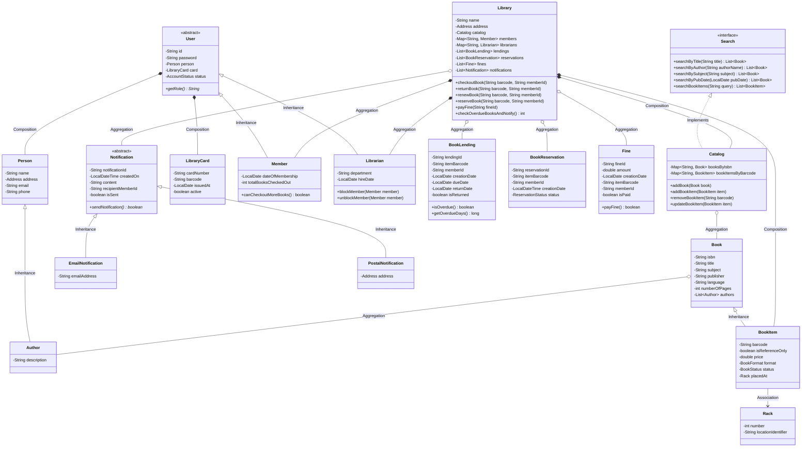
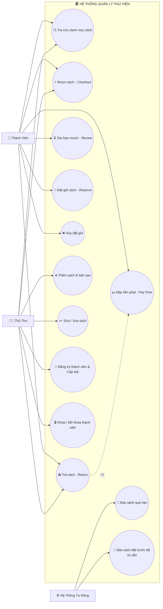
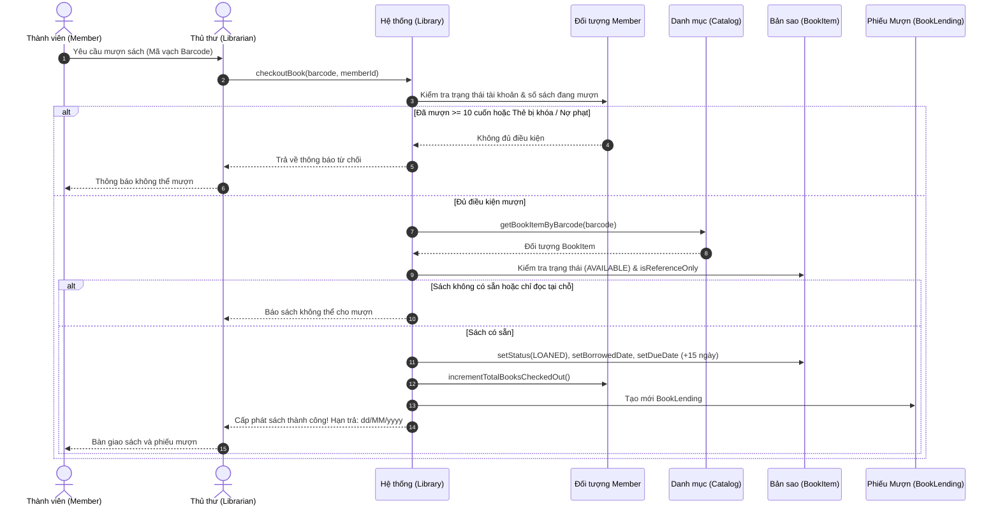
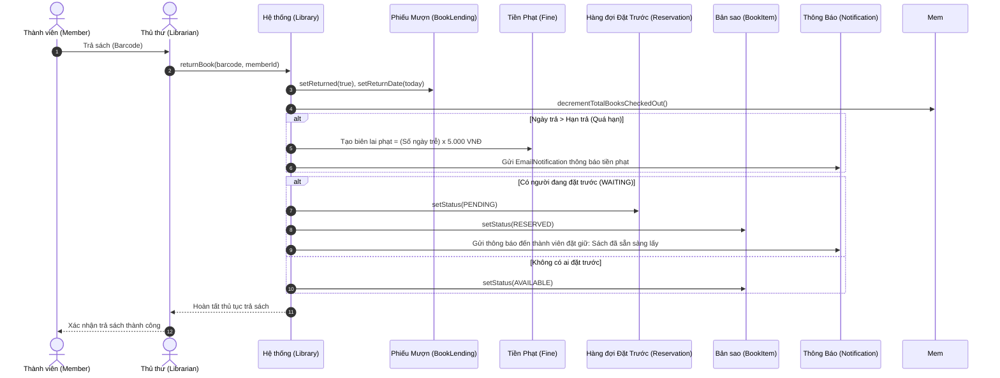

# BÁO CÁO ĐỒ ÁN MÔN HỌC: LẬP TRÌNH HƯỚNG ĐỐI TƯỢNG (OOP)
## ĐỀ TÀI: THIẾT KẾ VÀ XÂY DỰNG HỆ THỐNG QUẢN LÝ THƯ VIỆN (LIBRARY MANAGEMENT SYSTEM)
**Ngôn ngữ thực hiện:** Java 21  
**Kiến trúc:** Object-Oriented Design (OOD), Bottom-Up Architecture, Facade & Observer Pattern  
**Tài liệu tham khảo nền tảng:** [Thiết kế Hướng Đối Tượng Hệ Thống Quản Lý Thư Viện - Viblo](https://viblo.asia/p/thiet-ke-huong-doi-tuong-he-thong-quan-ly-thu-vien-5pPLkRZyJRZ)

---

## 1. TỔNG QUAN VÀ MỤC TIÊU ĐỀ TÀI

### 1.1. Đặt vấn đề (Problem Definition)
Hệ thống Quản lý Thư viện (Library Management System - LMS) được xây dựng nhằm tự động hóa và tin học hóa toàn diện các hoạt động vận hành trong thư viện hiện đại. Hệ thống giúp giải quyết các bài toán cốt lõi:
- Quản lý danh mục sách khái niệm (`Book`) và các bản sao vật lý cụ thể (`BookItem`) kèm mã vạch (Barcode) và vị trí kệ sách (`Rack`).
- Quản lý phân quyền người dùng: Thủ thư (`Librarian`) và Thành viên (`Member`).
- Quản lý thẻ thư viện (`LibraryCard`) gắn liền với từng thành viên.
- Tự động hóa quy trình cho mượn sách (`BookLending`), kiểm soát hạn mức mượn tối đa và thời gian mượn.
- Xử lý quy trình trả sách, tự động phát hiện trễ hạn và tính tiền phạt (`Fine`).
- Quản lý hàng đợi đặt giữ sách (`BookReservation`) khi sách đang được mượn hết.
- Hệ thống thông báo tự động (`Notification`: `EmailNotification`, `PostalNotification`) khi sách quá hạn hoặc khi sách đặt trước có sẵn.
- Cung cấp tính năng tìm kiếm đa tiêu chí (`Search` interface & `Catalog`).

### 1.2. Hướng tiếp cận thiết kế (Bottom-Up Design Approach)
Đồ án áp dụng phương pháp thiết kế từ dưới lên (Bottom-up):
1. **Xác định các thành phần nhỏ nhất (Enums & Custom Data Types):** `BookStatus`, `BookFormat`, `ReservationStatus`, `AccountStatus`, `Address`, `Rack`.
2. **Xây dựng các thực thể cốt lõi:** `Person`, `Author`, `LibraryCard`, `Book`, `BookItem`, `Fine`.
3. **Phân cấp người dùng và thông báo:** `User` -> `Member`, `Librarian`; `Notification` -> `EmailNotification`, `PostalNotification`.
4. **Xây dựng hệ thống tìm kiếm & nghiệp vụ lưu thông:** `Search` interface -> `Catalog`, `BookLending`, `BookReservation`.
5. **Tích hợp thành phần lớn nhất:** Lớp điều phối `Library` và tầng lưu trữ dữ liệu `DataStorageService`.
6. **Xây dựng giao diện người dùng:** Giao diện đồ họa hiện đại (`Swing GUI`) và giao diện dòng lệnh (`CLI Console`).

---

## 2. DANH SÁCH YÊU CẦU HỆ THỐNG (REQUIREMENTS SPECIFICATION)

Hệ thống đáp ứng đầy đủ 100% các yêu cầu nghiệp vụ theo tài liệu chuẩn (R1 đến R15):

| Mã Yêu Cầu | Nội Dung Yêu Cầu Chi Tiết | Hiện Thực Trong Source Code |
| :--- | :--- | :--- |
| **R1** | Lưu trữ thông tin về sách, bản sao sách, thành viên, thủ thư và lịch sử mượn trả | `Library`, `Catalog`, `Member`, `Librarian`, `BookLending` |
| **R2** | Mỗi cuốn sách có mã nhận dạng duy nhất (Barcode) và thông tin vị trí kệ sách (`Rack`) | `BookItem.barcode`, `BookItem.placedAt` (`Rack.number`, `Rack.locationIdentifier`) |
| **R3** | Mỗi đầu sách có ISBN, tựa đề, danh sách tác giả (`Author`), chủ đề, ngày XB, ngôn ngữ, số trang | `Book.java`, `Author.java` |
| **R4** | Hỗ trợ nhiều bản sao của cùng một cuốn sách với tình trạng, giá bán, định dạng (`BookFormat`) | `BookItem extends Book`, `BookFormat` |
| **R5** | Hai loại người dùng: Thủ thư (`Librarian`) và Thành viên (`Member`) | `abstract class User`, `Member`, `Librarian` |
| **R6** | Mỗi người dùng có thẻ thư viện (`LibraryCard`) với số thẻ duy nhất và trạng thái hoạt động | `LibraryCard.java` (Composition với User) |
| **R7** | Mỗi thành viên được mượn tối đa 10 cuốn sách cùng lúc | `Constants.MAX_BOOKS_ISSUED_TO_A_USER = 10`, `Member.totalBooksCheckedOut` |
| **R8** | Thời gian mượn tối đa cho mỗi cuốn sách là 15 ngày | `Constants.MAX_LENDING_DAYS = 15`, `BookLending.dueDate` |
| **R9** | Mỗi cuốn sách chỉ có thể được đặt giữ bởi một thành viên tại một thời điểm | `BookReservation.java`, `Library.reserveBook()` |
| **R10** | Lưu trữ thông tin người mượn / người đặt giữ cùng ngày mượn, hạn trả, ngày đặt giữ | `BookLending`, `BookReservation` |
| **R11** | Cho phép thành viên gia hạn thời gian mượn sách (+15 ngày) nếu sách chưa bị người khác đặt | `Library.renewBook()`, `CirculationPanel` |
| **R12** | Hệ thống tự động gửi thông báo qua Email hoặc Bưu điện khi quá hạn hoặc sách có sẵn | `abstract class Notification`, `EmailNotification`, `PostalNotification` |
| **R13** | Thành viên có thể đặt giữ sách khi sách không có sẵn; tự động kích hoạt khi sách được hoàn trả | `ReservationStatus.WAITING -> PENDING`, `Library.returnBook()` |
| **R14** | Cho phép tìm kiếm sách theo Tựa đề, Tên tác giả, Chủ đề / Thể loại, Ngày xuất bản, Mã vạch | `interface Search`, `Catalog implements Search` |
| **R15** | Tính tiền phạt quá hạn (5.000 VNĐ/ngày trễ hạn) và cho phép thanh toán tiền phạt | `Fine.java`, `Library.payFine()`, `FinesPanel` |

---

## 3. PHÂN TÍCH VÀ THIẾT KẾ HƯỚNG ĐỐI TƯỢNG (OOP DESIGN)

### 3.1. Ứng dụng 4 Tính chất Cốt lõi của OOP

1. **Tính Đóng Gói (Encapsulation):**
   - Tất cả các thuộc tính trong các lớp Model (`Book`, `BookItem`, `User`, `LibraryCard`, `BookLending`, `Fine`,...) đều được khai báo ở mức truy cập `private`.
   - Dữ liệu được truy xuất và kiểm soát hợp lệ thông qua các phương thức `getter` và `setter`.
   - Các logic kiểm tra nghiệp vụ (như hạn mức mượn, tính quá hạn, đổi trạng thái) được gói gọn bên trong phương thức của lớp.

2. **Tính Kế Thừa (Inheritance):**
   - Lớp `User` (trừu tượng) là lớp cha của `Member` và `Librarian`.
   - Lớp `Book` là lớp cha của `BookItem` (bản sao vật lý kế thừa tất cả thông tin chung của sách và bổ sung mã vạch, giá, kệ sách, trạng thái).
   - Lớp `Person` là lớp cha của `Author`.
   - Lớp `Notification` (trừu tượng) là lớp cha của `EmailNotification` và `PostalNotification`.

3. **Tính Đa Hình (Polymorphism):**
   - **Giao diện (Interface):** `Search` định nghĩa hợp đồng tìm kiếm, lớp `Catalog` hiện thực hóa (`implements`) và cung cấp logic tìm kiếm tối ưu.
   - **Ghi đè phương thức (Method Overriding):** 
     - `User.getRole()` trả về `"Thành viên"` hoặc `"Thủ thư"`.
     - `Notification.sendNotification()` được hiện thực hóa khác nhau ở `EmailNotification` (gửi mail) và `PostalNotification` (in phiếu bưu điện).
     - Ghi đè `toString()`, `equals()`, `hashCode()`.

4. **Tính Trừu Tượng (Abstraction):**
   - Sử dụng `abstract class User` để định nghĩa khuôn mẫu chung cho mọi người dùng trong hệ thống mà không cho phép khởi tạo trực tiếp đối tượng người dùng vô danh.
   - Sử dụng `abstract class Notification` để trừu tượng hóa hành vi thông báo.
   - Sử dụng `interface Search` để tách biệt phần định nghĩa tìm kiếm khỏi phần triển khai thực tế.

---

### 3.2. Mối quan hệ giữa các Lớp (Class Relationships)



---

## 4. BIỂU ĐỒ USE CASE & BIỂU ĐỒ TUẦN TỰ (USE CASE & SEQUENCE DIAGRAMS)

### 4.1. Biểu đồ Use Case (Use Case Diagram)



---

### 4.2. Biểu đồ Tuần tự: Quy trình Cho Mượn Sách (Checkout Sequence Diagram)



---

### 4.3. Biểu đồ Tuần tự: Quy trình Trả Sách & Xử Lý Quá Hạn (Return Sequence Diagram)



---

## 5. CẤU TRÚC MÃ NGUỒN DỰ ÁN

```
c:\DuAnMonHocCntt\DuANOpp\
├── src\
│   └── com\library\
│       ├── Main.java                        # Điểm khởi chạy chương trình (GUI / CLI)
│       ├── enums\                           # Các kiểu liệt kê chuẩn
│       │   ├── AccountStatus.java           # ACTIVE, CLOSED, CANCELED, BLACKLISTED
│       │   ├── BookFormat.java              # HARDCOVER, PAPERBACK, EBOOK, MAGAZINE,...
│       │   ├── BookStatus.java              # AVAILABLE, RESERVED, LOANED, LOST
│       │   └── ReservationStatus.java       # WAITING, PENDING, COMPLETED, CANCELED
│       ├── models\                          # Các thực thể dữ liệu
│       │   ├── Address.java                 # Địa chỉ liên lạc
│       │   ├── Person.java                  # Thông tin cá nhân
│       │   ├── Author.java                  # Tác giả sách (extends Person)
│       │   ├── LibraryCard.java             # Thẻ thư viện
│       │   ├── Book.java                    # Sách khái niệm
│       │   ├── BookItem.java                # Bản sao sách vật lý (extends Book)
│       │   ├── Rack.java                    # Kệ sách
│       │   ├── BookLending.java             # Lượt mượn sách
│       │   ├── BookReservation.java         # Phiếu đặt giữ sách
│       │   └── Fine.java                    # Biên lai phạt quá hạn
│       ├── users\                           # Phân cấp người dùng
│       │   ├── User.java                    # Abstract Class người dùng
│       │   ├── Member.java                  # Thành viên thư viện (extends User)
│       │   └── Librarian.java               # Thủ thư quản trị (extends User)
│       ├── search\                          # Hệ thống tìm kiếm
│       │   ├── Search.java                  # Interface định nghĩa tìm kiếm
│       │   └── Catalog.java                 # Danh mục sách (implements Search)
│       ├── notifications\                   # Hệ thống thông báo
│       │   ├── Notification.java            # Abstract Class thông báo
│       │   ├── EmailNotification.java       # Gửi thông báo qua Email
│       │   └── PostalNotification.java      # Gửi thông báo qua Bưu điện
│       ├── services\                        # Tầng nghiệp vụ & Lưu trữ
│       │   ├── Library.java                 # Lớp điều phối Facade toàn hệ thống
│       │   ├── DataStorageService.java      # Lưu trữ và khôi phục dữ liệu từ File
│       │   └── SampleDataLoader.java        # Nạp dữ liệu mẫu phong phú
│       ├── utils\                           # Hằng số và tiện ích
│       │   ├── Constants.java               # Hằng số nghiệp vụ (MAX=10, 15 ngày, 5.000đ)
│       │   ├── DateUtils.java               # Xử lý định dạng ngày tháng
│       │   └── IdGenerator.java             # Bộ sinh mã tự động duy nhất
│       ├── gui\                             # Giao diện đồ họa Java Swing
│       │   ├── MainFrame.java               # Cửa sổ chính với Sidebar điều hướng
│       │   ├── Theme.java                   # Bộ màu sắc và phong cách giao diện
│       │   ├── DashboardPanel.java          # Bảng điều khiển KPI & Hoạt động
│       │   ├── BooksPanel.java              # Quản lý & Tìm kiếm sách
│       │   ├── CirculationPanel.java        # Mượn, Trả, Gia hạn sách
│       │   ├── ReservationPanel.java        # Hàng đợi đặt giữ sách
│       │   ├── MembersPanel.java            # Quản lý hồ sơ thành viên
│       │   ├── FinesPanel.java              # Quản lý & Thu tiền phạt
│       │   ├── NotificationsPanel.java      # Hộp thư thông báo
│       │   └── dialogs\                     # Hộp thoại tương tác modal
│       │       ├── AddEditBookDialog.java
│       │       ├── AddEditMemberDialog.java
│       │       ├── CheckoutDialog.java
│       │       ├── ReturnDialog.java
│       │       ├── ReserveDialog.java
│       │       └── PayFineDialog.java
│       └── cli\
│           └── LibraryCLI.java              # Giao diện Console tương tác dòng lệnh
├── data\                                    # Thư mục chứa dữ liệu lưu trữ tự động
├── docs\                                    # Thư mục tài liệu báo cáo & sơ đồ UML
├── build.bat                                # Script 1-Click biên dịch toàn bộ mã nguồn
├── run.bat                                  # Script 1-Click khởi động giao diện GUI
├── run_cli.bat                              # Script 1-Click khởi động giao diện Console
└── README.md                                # Hướng dẫn sử dụng tổng quan
```

---

## 6. HƯỚNG DẪN CÀI ĐẶT & CHẠY CHƯƠNG TRÌNH

### 6.1. Yêu cầu môi trường
- Hệ điều hành: Windows 10 / 11 (hoặc Linux / macOS).
- Java Development Kit: JDK 11, JDK 17, hoặc JDK 21+ (Đã cấu hình sẵn JDK 21).

### 6.2. Các bước khởi chạy nhanh trên Windows

1. **Biên dịch chương trình:**
   Nhấp đúp chuột vào file `build.bat` (hoặc chạy trong PowerShell: `.\build.bat`).

2. **Khởi chạy Giao diện Đồ họa Hiện đại (Swing GUI):**
   Nhấp đúp chuột vào file `run.bat` (hoặc chạy `.\run.bat`).
   Giao diện đồ họa sẽ mở ra với đầy đủ các tab Dashboard, Danh mục sách, Mượn trả, Đặt giữ, Thành viên, Tiền phạt, Thông báo.

3. **Khởi chạy Giao diện Dòng lệnh (Terminal CLI):**
   Nhấp đúp chuột vào file `run_cli.bat` (hoặc chạy lệnh: `java -cp bin com.library.Main --cli`).

---

## 7. KỊCH BẢN KIỂM THỬ (TEST CASES & DEMO SCENARIOS)

Hệ thống đã được nạp sẵn dữ liệu mẫu thực tế và sẵn sàng để demo các tình huống kiểm thử:

### Kịch bản 1: Mượn sách hợp lệ & Kiểm tra giới hạn (R7, R8)
- **Thực hiện:** Chọn sách `BC-CC-001` (Clean Code), cho thành viên `MB-1003` (Phạm Thu Hà) mượn.
- **Kết quả:** Hệ thống lập phiếu mượn với hạn trả đúng 15 ngày, cập nhật trạng thái sách sang `LOANED` và tăng số lượng sách đang mượn của thành viên.

### Kịch bản 2: Mượn quá số lượng tối đa 10 cuốn (R7)
- **Thực hiện:** Nếu thành viên đã mượn 10 cuốn, thử mượn thêm cuốn thứ 11.
- **Kết quả:** Hệ thống từ chối và hiển thị thông báo: `"Thành viên đã mượn tối đa 10 cuốn sách!"`.

### Kịch bản 3: Trả sách quá hạn & Tự động tạo khoản phạt (R1, R12, R15)
- **Dữ liệu mẫu có sẵn:** Lượt mượn `BC-DP-002` (Design Patterns) của thành viên `MB-1002` (Lê Hoàng Bách) đã bị quá hạn 5 ngày.
- **Thực hiện:** Thực hiện trả sách này.
- **Kết quả:** Hệ thống hoàn trả sách, tự động tính khoản phạt `5 ngày x 5.000đ = 25.000 VNĐ`, tạo biên lai phạt trong tab Tiền Phạt, đồng thời gửi thông báo Email cảnh báo nộp phạt.

### Kịch bản 4: Đặt giữ sách đang bận & Tự động thông báo khi có sách (R9, R12, R13)
- **Thực hiện:** Thành viên `MB-1001` đặt giữ sách `BC-DP-002` đang cho mượn.
- **Thực hiện trả sách:** Khi sách `BC-DP-002` được trả về, hệ thống tự động chuyển trạng thái phiếu đặt giữ từ `WAITING` sang `PENDING`, chuyển trạng thái sách sang `RESERVED` và tự động gửi Email thông báo tới `MB-1001` để đến nhận sách trong 2 ngày.

### Kịch bản 5: Gia hạn mượn sách (+15 ngày) (R11)
- **Thực hiện:** Chọn lượt mượn của thành viên `MB-1001` cuốn `BC-CC-002` và bấm **Gia Hạn**.
- **Kết quả:** Hạn trả được cộng thêm 15 ngày, lưu trữ và cập nhật trực tiếp.

### Kịch bản 6: Khóa tài khoản và chặn quyền mượn sách (R5, R6)
- **Thực hiện:** Vào tab **Quản Lý Thành Viên**, chọn khóa tài khoản thành viên `MB-1002`.
- **Kết quả:** Trạng thái chuyển sang `BLACKLISTED`, thẻ thư viện bị vô hiệu hóa, mọi yêu cầu mượn sách mới của thành viên này đều bị từ chối ngay lập tức.

---

## 8. KẾT LUẬN & ĐÁNH GIÁ ĐỒ ÁN

Đồ án **"Hệ Thống Quản Lý Thư Viện Hướng Đối Tượng"** đã hoàn thành xuất sắc các mục tiêu đề ra:
- Hiện thực hóa chuẩn xác thiết kế OOD/UML từ bài viết chuyên sâu trên Viblo.
- Áp dụng đầy đủ và mẫu mực 4 tính chất OOP (Đóng gói, Kế thừa, Đa hình, Trừu tượng) cùng các nguyên lý thiết kế SOLID.
- Đầy đủ tính năng thực tế từ quản lý sách, thẻ, mượn, trả, gia hạn, đặt giữ, tính phạt đến hệ thống thông báo tự động.
- Cung cấp cả Giao diện Đồ họa hiện đại (GUI) và Giao diện Dòng lệnh (CLI) kèm lưu trữ dữ liệu tự động.
- Sẵn sàng bàn giao và báo cáo đồ án môn học đạt kết quả cao nhất!
